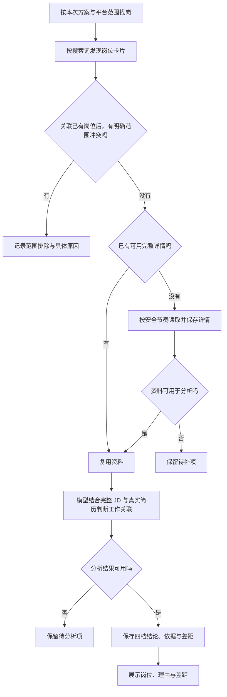

# 02 找岗与岗位判断：先看实际工作，再判断值不值得投

[返回指南首页](README.md) · [上一章：首次使用](01-getting-started.md) · [下一章：沟通、消息与进展](03-communication-and-progress.md)

找岗时，先回答三个问题：**岗位主要做什么，我做过的哪些工作与它相关，这个机会值不值得争取？** 推荐结果会把工作内容、相关经历和具体差距一起讲清楚。

## 1. 从哪里开始，完成后看到什么

进入 **今日任务**，选择方案与平台，检查“本次找岗范围”，再启动一轮岗位发现。按钮会随本轮状态变化；有未完成任务时，可能显示继续或查看进度，而不是新建一轮。

结果通过 **发现岗位** 和 **岗位记录** 查看，包括岗位内容、匹配依据、具体差距、推荐档位和待处理状态。

“更多找岗工具”还提供日常范围、扩大范围、补全详情和更新岗位状态等入口。补资料、重试模型与重新搜索解决不同问题，不必每次从头开始。

## 2. 一轮找岗怎样展开

### 这一轮使用开始时确定的条件

城市、搜索条件、关键词和匹配依据在开始时确定。这样，一轮结果对应同一套条件，方便比较。运行中修改平台条件时，当前任务仍沿用开始时的范围；后续任务再使用新范围。

选择双平台后，系统分别在 BOSS 和智联寻找岗位，并保存两边的结果。

### 卡片负责发现线索，完整 JD 负责工作判断

岗位卡片能提供名称、公司、地点、薪资等线索，但通常讲不清日常职责。标题里写“AI”可能是开发，也可能主要是销售；标题没写某个框架，也可能接受同类方案。

系统先检查你设定的工作地点、工作性质、明确排除条件和薪资底线，再读取详情判断职责与能力。这样能先排除范围明显不符的岗位，把分析重点放在值得了解的机会。

例如，严格薪资模式下，你要求至少 15K，而岗位最高只有 12K，可以直接排除。岗位薪资高于你的目标时，仍按实际工作判断是否适合。

### 资料不足时保留任务

详情没读到、招聘状态不明或分析失败的岗位，会保留在相应待处理列表。你可以补详情、更新状态或重试分析，继续完成这一步。

BOSS 从搜索页右栏读取岗位详情。一次读取需要暂停时，已保存的结果与未完成项都会保留，后续接着处理。

需要暂时离开或关闭本轮时，按[暂停与结束的步骤](07-settings-data-and-recovery.md#暂停与结束怎么选)操作。

## 3. 模型怎样判断，而不是只数技术词

系统会通读完整 JD，对照匹配卡对应的原简历、已整理的经历和你的求职条件。

它按以下关系组织结论：

1. **理解工作重心。** 日常要解决什么问题，主要交付是什么；不是先看标题听起来像哪类人。
2. **寻找真实支持。** 你做过的哪些工作直接对应，哪些能力可以迁移，依据来自哪里。
3. **辨别重要差距。** 差距是某种工具的名称，还是确实影响主体交付的经验、能力或责任范围。
4. **给出投递价值。** 结合以上材料形成四档结论，用自然语言解释值得争取的原因与需要考虑的问题。

例如，一个岗位要求搭建知识问答应用，而你做过检索接口与应用接入；某个框架没写在简历里，可以是具体工具差距，不能直接扩大成“没有应用开发能力”。反过来，只做过应用接入，也不能据此说你已具备大模型训练经验。

### 程序在这里做什么

程序把推荐理由与原 JD、简历材料对应起来。例如，解释“你有接口开发经验”时，要能找到简历里的实际工作，而不是把 JD 要求的能力直接写成你的经历。

分析完成后，系统保存推荐档位、相关经历、差距和说明。查看完整分析时，可以对照原文理解推荐的来由。

## 4. 现实中的省略与差距怎样处理

| 情况 | 合理的初筛方式 |
| --- | --- |
| 正常完整简历只列已完成本科 | 按本科理解，不猜隐藏硕士 |
| 普通已完成学历没有额外写“全日制” | 按常见背景理解，照常判断岗位相关性 |
| JD 写“计算机及相关专业”，本人为电子信息且有实际软件工作 | 结合相邻专业与工作内容判断，不把列举专业当封闭名单 |
| 相关项目存在，但没列某框架 | 解释可迁移的工作与具体工具差距，不把未列出写成完全不会 |
| 经验年限略有差距，但已交付相近工作 | 结合职责、成熟度和实际成果判断竞争差距，不机械一票否决 |
| 岗位主要做另一类工作，或与明确的重要条件冲突 | 说明工作与经历具体差在哪里 |

这些情况都要结合实际招聘情境，重点看它们是否影响工作交付和投递价值。

## 5. 四档结论与等待状态有什么区别

| 结果 | 怎么理解 | 后续怎么做 |
| --- | --- | --- |
| 主投 | 做过与岗位主要工作直接相关的事，值得优先考虑 | 优先查看和联系 |
| 可投 | 做过相近工作，能力能用过来，同时有一些差距 | 看清差距后考虑投递 |
| 慎投 | 有相关经历，但主要任务或责任范围差距较大 | 愿意尝试时也可以选择 |
| 不推荐 | 主要工作明显不同，或与重要条件冲突 | 查看原因，优先考虑其他机会 |
| 等待分析 | 分析缺失、失败或已过期 | 处理分析任务，暂不当作正式判断 |
| 等待补齐资料 | 完整 JD 尚不可用 | 补详情，不凭标题猜推荐 |
| 等待确认招聘状态 | 需要更新招聘活跃情况 | 更新岗位状态后再看 |

四档帮助你安排投递优先级；等待状态则告诉你还有哪一步需要继续处理。

### 为什么慎投也可以进入候选清单

投递是在寻找机会。有实际相关经历、但存在差距的岗位，也值得留作选择。因此“投递候选”包含主投、可投、慎投，清单会在数量上限内优先选择主投、可投，再保留合适的慎投。

系统还会继续寻找更合适的主投、可投，避免仅靠慎投填满本轮目标。

## 6. 为什么同一岗位不会每次从零处理

### 去重保存的是同一个岗位，不抹掉你的进度

在同一平台的不同关键词下遇到同一个岗位时，系统会把新看到的信息归到已有岗位记录，继续沿用此前进度。已投、跳过或沟通过的状态都会保留，方便你接着处理。

同公司、同名称、同地点的相似岗位会提示疑似重复，跨平台岗位分别保留，方便你对照招聘来源。

### 已有详情和分析可以接着用

近期已有可信完整详情、卡片关键内容没有已知冲突时，可以复用详情，减少平台访问。详情缺失、卡片变化或没有可用近期观察时，再补读或刷新；不是每次打开记录都会重新抓取网站。

输入和分析配置相同时，也可以直接使用已有分析结果，减少重复等待和模型开销。

### 依据变了，旧结论可能失效

用于匹配的基础简历或画像、确认卡、方案、岗位内容、匹配模式或相关模型与分析版本变化后，旧结论可能被标记为过期。历史仍保留，当前要用的结论需要按新依据更新。

新增经历希望用于找岗时，到资料页更新并确认匹配卡。简历工作室主要调整投递表达，找岗仍以匹配卡所对应的基础资料为依据。

所以：**补详情**解决资料缺失，**更新岗位状态**解决招聘状态，**重试分析**解决分析未完成。分析失败时，可以直接使用已保存的 JD 重试，省去重复搜索。
