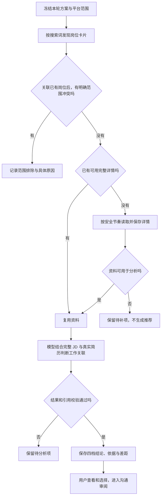

# 02 找岗与岗位判断：先看实际工作，再判断值不值得投

[返回指南首页](README.md) · [上一章：首次使用](01-getting-started.md) · [下一章：沟通、消息与进展](03-communication-and-progress.md)

这个模块的核心问题是：**这份岗位主要做什么，我的实际经历能支持哪些工作，是否值得争取？** 它负责初筛和解释，不代替 HR 完成所有学历、学制和入职资格核验。

## 1. 从哪里开始，完成后看到什么

进入 **今日任务**，选择方案与平台，检查“本次找岗范围”，再启动一轮岗位发现。按钮会随本轮状态变化；有未完成任务时，可能显示继续或查看进度，而不是新建一轮。

结果通过 **发现岗位** 和 **岗位记录** 查看，包括岗位内容、匹配依据、具体差距、推荐档位和待处理状态。

“更多找岗工具”还提供日常范围、扩大范围、补全详情和更新岗位状态等入口。补资料、重试模型与重新搜索解决不同问题，不必每次从头开始。

## 2. 一轮找岗怎样展开

### 先冻结范围，避免一轮之中依据不断变化

这轮使用的城市、搜索条件、关键词与匹配依据在开始时确定。任务运行后再到平台修改条件，不应悄悄改变已经开始的这一轮；新范围用于后续任务。

双平台会分别安排任务，各自保存结果。BOSS 内部仍按串行页面操作与共享节奏工作，不能把“双平台同时”理解为一个账号并行开很多详情页。

### 卡片负责发现线索，完整 JD 负责工作判断

岗位卡片能提供名称、公司、地点、薪资等线索，但通常讲不清日常职责。标题里写“AI”可能是开发，也可能主要是销售；标题没写某个框架，也可能接受同类方案。

因此，本地会先处理明确边界，例如用户确认的工作地点、工作性质、硬排除条件和严格薪资底线；需要理解职责和能力的问题留给完整 JD。程序没有把普通职业名称建立成默认职业黑名单，不能仅靠标题判定一个人是否适合。

严格薪资模式也有具体含义：岗位明确的最高薪资仍低于你设置的下限，才可能形成这类下界冲突；岗位薪资高于目标上限，不等于你不能胜任。

### 资料不足时保留任务

详情没有读到、招聘状态不明或模型请求失败，说明处理还没完成。它们不能冒充慎投或不推荐。

BOSS 的普通扫描详情路径是已核对的搜索页右栏。保留在代码里的其他研究读取方式，不是产品在失败时随意切换的通用后备路径。读取受安全节奏、页面状态或额度影响时，待补岗位保留，之后从进度继续。

## 3. 模型怎样判断，而不是只数技术词

当前默认是**整份 JD 工作判断**。一次逻辑分析会综合：完整岗位原文、已确认匹配卡所对应的原简历、结构化经历和用户筛选上下文。

它按以下关系组织结论：

1. **理解工作重心。** 日常要解决什么问题，主要交付是什么；不是先看标题听起来像哪类人。
2. **寻找真实支持。** 你做过的哪些工作直接对应，哪些能力可以迁移，依据来自哪里。
3. **辨别重要差距。** 差距是某种工具的名称，还是确实影响主体交付的经验、能力或责任范围。
4. **给出投递价值。** 结合以上材料形成四档结论，用自然语言解释值得争取的原因与需要考虑的问题。

例如，一个岗位要求搭建知识问答应用，而你做过检索接口与应用接入；某个框架没写在简历里，可以是具体工具差距，不能直接扩大成“没有应用开发能力”。反过来，只做过应用接入，也不能据此说你已具备大模型训练经验。

### 程序在这里做什么

程序检查输入是否可用、岗位和候选人来源是否对应、返回档位是否合法、引用是否真实存在。候选人的能力支持必须来自候选材料，不能拿 JD 自己写的要求充当本人经历。

通过这些检查后，默认主路径使用模型给出的四档结论。**它不再按旧的 70%/30% 二维评分表重新计算推荐。** 旧分数和兼容路径仍可能用于排序、历史记录或其他视图，不能理解成统一的录用分数。

引用校验只能证明结果指向了哪些材料，不能自动证明模型没有误解材料。内容是否符合现实，仍需单独看。

## 4. 现实中的省略与差距怎样处理

| 情况 | 合理的初筛方式 |
| --- | --- |
| 正常完整简历只列已完成本科 | 按本科理解，不猜隐藏硕士 |
| 普通已完成学历没有额外写“全日制” | 按常见背景理解，不仅因没写就降档或要求先证明；也不声称已经做过学历认证 |
| JD 写“计算机及相关专业”，本人为电子信息且有实际软件工作 | 结合相邻专业与工作内容判断，不把列举专业当封闭名单 |
| 相关项目存在，但没列某框架 | 解释可迁移的工作与具体工具差距，不把未列出写成完全不会 |
| 经验年限略有差距，但已交付相近工作 | 结合职责、成熟度和实际成果判断竞争差距，不机械一票否决 |
| 岗位主体是另一类工作，或有明确不可替代边界冲突 | 把实际不适合的原因讲清，不靠同名技术强行匹配 |

“未提及”既不能随意补成“肯定有”，也不能一律写成“肯定没有”。判断重点是招聘情境中这个信息是否真的改变投递价值。

例如，“参与项目”不能改成“主导项目”；“没列全日制”又不能自动解释为非全日制。这两个例子方向相反，但都要求尊重现实材料。

## 5. 四档结论与等待状态有什么区别

| 结果 | 怎么理解 | 后续怎么做 |
| --- | --- | --- |
| 主投 | 主体工作有较强直接支持，值得优先投入 | 优先核对岗位与沟通内容 |
| 可投 | 有直接或有意义的迁移支持，值得争取 | 查看差距后正常考虑投递 |
| 慎投 | 有实际关联，但主体交付或责任存在实质差距 | 结合投入成本决定是否尝试，不自动丢弃 |
| 不推荐 | 主体工作明显不同，或存在已知重要边界冲突 | 查看具体原因，避免低价值投入 |
| 等待分析 | 分析缺失、失败或已过期 | 处理分析任务，暂不当作正式判断 |
| 等待补齐资料 | 完整 JD 尚不可用 | 补详情，不凭标题猜推荐 |
| 等待确认招聘状态 | 招聘状态等来源证据需要更新 | 核对状态，不能当作能力不匹配 |

四档描述的是本次材料下的投递建议，不是对一个人永久能力的标签，也不是录用概率。

### 为什么慎投也可以进入候选清单

投递是在寻找机会，初筛不应替用户过早放弃所有有差距的岗位。当前“投递候选”包含主投、可投、慎投；默认勾选受数量上限和岗位可用性约束，并按优先顺序安排，不等于把所有结果全部选中。

同时，慎投不会充当“已经找到足够主投/可投岗位”的库存，让系统提前停止寻找更合适的机会。**保留尝试机会**与**保证主要候选质量**分别处理。

默认勾选仍不等于发送授权。真正联系需要下一章的具体清单确认和开始动作。

## 6. 为什么同一岗位不会每次从零处理

### 去重保存的是同一个岗位，不抹掉你的进度

同平台的稳定岗位来源编号对应同一个主记录；在多个关键词下遇到它，会保留新的观察记录，复用已有进度。已投、跳过或沟通过的状态，不因为又抓到一张卡片就被清空。

同公司、同名称、同地点也可能只是“疑似重复”。跨平台相似岗位不承诺自动合并，避免把实际不同的招聘机会混成一个。

### 详情与模型结果分别缓存

近期已有可信完整详情、卡片关键内容没有已知冲突时，可以复用详情，减少平台访问。详情缺失、卡片变化或没有可用近期观察时，再补读或刷新；不是每次打开记录都会重新抓取网站。

模型结果也可复用，但必须对应相同的输入、任务与分析配置。一次分析可能命中缓存，也可能因为格式恢复等多次请求模型，不保证每个岗位只发生一次模型请求。

### 依据变了，旧结论可能失效

用于匹配的基础简历或画像、确认卡、方案、岗位内容、匹配模式或相关模型与分析版本变化后，旧结论可能被标记为过期。历史仍保留，当前要用的结论需要按新依据更新。

仅在简历工作室启用新的投递版本，不会自动替换匹配卡绑定的基础简历和画像。要改变找岗判断依据，需要在资料流程中更新并确认相应匹配依据；投递表达版本与基础匹配资料是两个层次。

所以：**补详情**解决资料缺失，**更新岗位状态**解决招聘状态，**重试分析**解决分析未完成。模型失败并不意味着必须再搜索和读取一遍所有岗位。

## 7. 怎么判断这一模块做得好不好

先看三个实际问题：真正适合的岗位有没有被漏掉，明显不适合的有没有被推荐，相关但有差距的机会有没有被合理保留。

再检查解释：有没有准确讲出工作重心、引用真实经历、说明重要差距，有没有把普通信息省略过度审计，或把材料中的“参与”扩大成“主导”。

这是一套验收方向，不是已经证明全体岗位百分之百准确。技术检查通过后，还要用具体岗位和真实招聘常识判断输出。

### 核对实现的位置

- [默认配置](../../src/config.js)、[岗位分析流程](../../src/core/job_analysis.js)。
- [完整 JD 工作判断](../../src/core/job_work_matching.js)、[最终决策入口](../../src/core/job_match_decision.js)。
- [本地范围规则](../../src/core/scoring.js)、[默认选择](../../src/core/decision_policy.js)、[候选库存](../../src/core/workflow_inventory.js)。
- [岗位保存](../../src/storage/job_store.js)、[结果有效性](../../src/core/analysis_revision.js)、[今日任务](../../src/dashboard/pages/today.js)。
