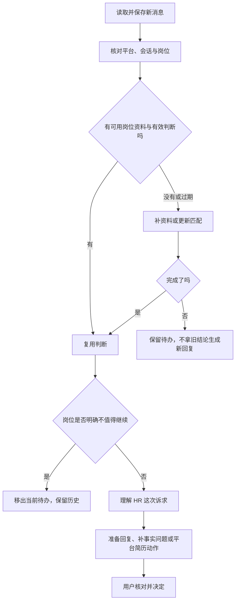

# 03 沟通、消息与进展：把准备、确认和执行分清楚

[返回指南首页](README.md) · [上一章：找岗判断](02-job-discovery-and-matching.md) · [下一章：简历工作室](04-resume-workspace.md)

主动联系岗位、回复已有消息、发送平台简历请求和记录面试进度，是不同动作。项目分别安排流程，避免你只是查看或保存，就意外产生对外操作。

## 1. 一轮任务在哪一步等你决定

你从 **今日任务** 启动一轮后，系统检查方案、平台、模型与候选库存：

- 库存不足时，后台继续搜索、补详情与分析，页面更新进度。
- 已有足够可用候选时，可以直接进入审阅，不重复采集。
- 进入等待确认阶段后，等你检查清单；分析完成不等于开始联系。

这里的后台运行是“已启动的这一轮继续处理”，不是无人值守地定时开下一轮。关闭一个展示页面与结束后台进程不同，要明确控制本轮，应使用 **暂停本轮** 或 **结束本轮…**。

暂停会等当前安全步骤保存后停下，可沿原轮继续；结束需要明确确认，保留已有结果，但该轮不能再恢复。条件变动时按页面提示选择恢复方式，不能无声混用两套范围。

## 2. 主动联系：先固定清单，再明确开始

进入 **沟通清单与记录**，或从待处理岗位进入本次清单：

1. 查看具体岗位、公司、推荐理由和风险，勾选或取消对象。
2. 点击 **确认清单**，保存本次固定批次。
3. 再点击 **开始沟通**，系统才进入真实平台操作。
4. 程序逐岗核对身份与页面，执行一次动作，核验并记录结果后，再处理下一项。

固定批次保存的是你确认的具体岗位与平台范围。之后搜索结果变化，也不能换一个岗位冒充你已确认的对象。

### 什么才算成功

预算预留、打开详情、发出点击都不等于成功。需要核对平台结果，分别记录成功、已沟通过、停止、未成功或结果不明确。

如果一次点击后无法确认是否创建了会话，就停止，不为“试一下”再点一次。你应先到平台核对实际结果，再按页面的人工处置入口记录依据。

### 两个平台的主动沟通能力不同

| 平台 | 当前范围 |
| --- | --- |
| BOSS | 已有固定批次与串行沟通路径；每次新批次仍需具体确认。批量动作使用平台原有“立即沟通”路径与平台招呼语 |
| 智联 | 有独立执行器和本地记录，但整批主动沟通仍受待验收校准限制；当前只允许受控的单岗验收路径，不能当作任意批量已完成验收 |

双平台找岗、消息读取和文字回复的存在，不代表所有平台的主动批量联系能力完全一样。

## 3. 定制招呼语在哪里，和批量动作什么关系

岗位详情和支持证据完整的投递候选，可使用 **生成定制招呼语**。系统结合真实经历与岗位生成本地文案，已有稿件可从 **查看上次招呼** 重开。

它帮助你准备表达，不代表文案已经发送。当前 BOSS 批量执行也不是把每份模型定制文案自动填进 HR 聊天。需要使用哪段文字，应按对应页面的具体操作处理，不能把“生成成功”记作联系成功。

## 4. 消息与回复：先搞清楚发生了什么

进入 **消息与回复**，点击 **同步最新消息**。页面会整理现在需要处理、等待对方、待补回复建议以及已结束的记录。

它可以接入使用 OfferGo 之前就存在的会话，不要求先通过本项目主动打招呼。同步是用户发起的读取，不是默认一直监听所有新消息。

### 一条新消息的处理顺序

**新消息不等于每次都重新做岗位匹配。** 有效判断会复用；新问题需要新的回复建议。陌生岗位缺资料或旧分析过期时，才补充或更新判断。

同样，慎投不等于明确不值得继续，不会因此自动静默丢掉。资料未完成和模型失败也不等于候选人不合适。

### 平台覆盖不完整怎么办

一个平台读取成功，不能替另一个平台报成功；部分会话没有读全，也不能说全部历史消息已取得。超过可操作时间窗口的旧消息保留历史，不继续展示旧发送操作。

页面首次衔接的近期范围与可发送回复的窗口并非一回事；当前超过七天未处理的历史消息不会继续要求发送。看到“已同步”时，要结合平台与覆盖状态理解。

## 5. 缺少个人事实时，为什么先问你

HR 问“下周什么时候能面试”，模型不能从项目经历推导你的日程。已有资料没有有效答案时，系统先在项目中提问，保存你的实际补充后再准备回复。

可以复用的事实带有适用范围与时效：

| 事实类型 | 当前默认有效期 |
| --- | --- |
| 城市、期望薪资 | 30 天 |
| 在职、到岗、面试可用时间 | 7 天；具体日期已经过去时，可更早要求更新 |
| 出差、搬迁、加班意愿 | 90 天 |

某次离职、空档或短项目解释还必须对应那段经历，不能套到所有公司。仍有效且适用的资料可以复用，避免每次回复都重新询问。

这和岗位初筛不同：不能因为简历没写全日制就制造拒绝理由；但要向 HR 发出“我周二下午有空”这种个人承诺，就需要真实依据。

## 6. 回复草稿怎样变成真正发送

查看 HR 原文和对应岗位，修改草稿，核对事实后使用单条 **确认发送**，或 **确认并串行发送 N 条**。

**这里的确认会冻结当前目标、最新 HR 消息、草稿版本和正文，并立即调度发送。** 它不同于主动联系清单“确认之后还要再开始”的两步流程。

程序发送前再次检查会话、岗位、最新消息和编辑框，填入文字，单次点击，并核对结果。同一批回复只能属于同一平台，同一会话不能同时选多个候选稿。

如果复制文字，动作只是到本机剪贴板；点击 **我已手动发送**，表示你已经自行发送并更新本地记录，不会再代你点击一次。复制、手动发送记录和平台核验成功是不同事实。

### 用户修改过的表达怎样被复用

完整的修改稿和采用记录可以保存。系统按现有学习规则，从用户实际改动中提取可用事实或表达；没有修改的模型稿只记录采用，不自动升级为权威个人事实。

相关回答和确认资料可在 **我的沟通资料** 中管理，调整适用范围、修改或停止使用。提取失败也应保留已经写好的完整回答，不把本地输入一起丢掉。

## 7. HR 索要简历，与文字回复分别处理

| 请求 | 当前动作 |
| --- | --- |
| BOSS 索简历 | **确认发送 BOSS 中最近更新的附件简历**；重新核对目标与附件更新时间，无法唯一确认时停止 |
| 智联简历请求 | 根据对应请求选择同意发送或拒绝，核对后执行一次 |
| 同时问了一个问题 | 另行准备并确认文字回复，不能只发简历就记为问题已答完 |

这里处理的是平台已经存在的附件或请求，不是把简历工作室的新稿自动上传。索要简历、发送动作成功和 HR 已经读过简历，仍是三个不同状态。

## 8. 面试、Offer 和本地进展怎样记录

岗位进展面板保存等待回复、需要处理、面试邀请、面试安排、完成面试、Offer 或结束等状态，并保留事件。

你可以按实际情况使用 **标记已安排面试**、**标记已完成面试**、**标记已收到 Offer**、**关闭机会** 等入口；安排面试需要相应说明和时间。发现错误时，使用带原因的纠正或重新开启，而不是重抓岗位来覆盖进展。

这些按钮更新本地记录，不会自动替你接受平台面试、填写表单或回复 HR。统计使用这些可核对事件形成当前状态，用户纠正也会影响统计，不能简单把历史最高阶段永久累加。

## 9. 没回复的岗位会自动催吗

不会定时自动催。**无回复跟进** 工作台先筛选仍有联系价值、已确实联系、会话可信、经过观察窗口且可判断仍未回复的岗位。

当前自动筛选的跟进候选以主投、可投为范围；状态未知、已经约面、拒绝或退出的机会不应自动催。

你点击 **准备跟进草稿**，审核后再 **确认发送** 或批量串行发送。新回复或状态变化后，候选资格重新计算。旧岗位卡里的“生成一次跟进文案”是另一种本地生成入口，不代表已安排定时发送。

## 10. 一次对外动作的共同原则

先准备可核对的对象与内容，再由用户明确确认；执行逐项保存结果。结果不明确时，先核实，再决定如何处置。重启程序或恢复页面本身不构成重发授权。

这个设计让“整理得更快”与“用户仍能掌握外部动作”同时成立。

### 核对实现的位置

- [单轮任务](../../src/application/workflow/index.js)、[双平台安排](../../src/application/workflow/dashboard_service.js)。
- [主动沟通](../../src/application/communication/index.js)、[执行与结果](../../src/core/communication_executor.js)。
- [消息发现](../../src/core/message_discovery.js)、[岗位上下文](../../src/application/message_discovery/job_context.js)。
- [回复确认与发送](../../src/application/message_reply_sending/index.js)、[平台简历动作](../../src/application/message_actions/index.js)。
- [本人进展](../../src/core/candidate_progress.js)、[事实有效期](../../src/core/candidate_fact_policy.js)、[无回复跟进](../../src/core/message_follow_up.js)。
