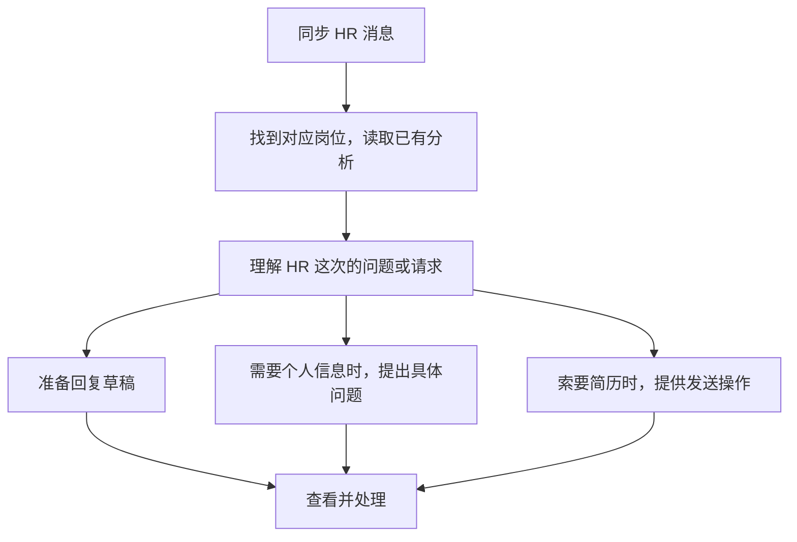

# 03 沟通、消息与进展

[返回指南首页](README.md) · [上一章：找岗判断](02-job-discovery-and-matching.md) · [下一章：简历工作室](04-resume-workspace.md)

选好岗位后，可以主动联系 HR；收到消息后，可以处理问题和简历请求。这一章按这两个场景介绍操作，再说明怎样记录后续进展。

## 1. 选择想联系的岗位

找岗完成后，进入 **沟通清单与记录**，查看本次候选岗位。有足够的已有候选时，系统也可以直接整理清单，节省重新搜索的时间。

1. 看岗位、公司、推荐理由和需要留意的地方，勾选想联系的对象。
2. 点击 **确认清单**，保存本次选择。
3. 点击 **开始沟通**，系统逐项联系并记录结果。

清单保存的是当时选中的具体岗位。即使后来换了搜索词，也会按这份清单处理，方便你核对联系过谁。

### 结果在哪里看

执行页面会显示成功、已沟通过、停止或结果不明确等情况。系统每处理一项，就核对结果并保存，再继续下一项。

如果显示“结果不明确”，先到平台查看是否已经建立会话，再在页面记录核对结果，避免重复联系。

### BOSS 与智联目前有什么区别

| 平台 | 主动联系 |
| --- | --- |
| BOSS | 支持确认清单后逐项开始沟通，使用平台原有招呼语 |
| 智联 | 主动联系仍在单岗验证阶段，整批功能尚未开放 |

两平台都提供找岗与消息处理入口，具体操作按对应页面进行。

## 2. 想写一段更贴合岗位的招呼语

在已完成分析、资料齐全的候选岗位中，点击 **生成定制招呼语**。系统会结合你的经历与岗位内容准备文案，已有稿件可从 **查看上次招呼** 重开。

你可以复制文案到平台聊天框，按需要修改后使用。BOSS 的批量沟通使用平台原有招呼语，与这里准备的定制稿分别使用。

## 3. 收到 HR 消息，怎么处理

进入 **消息与回复**，点击 **同步最新消息**。系统整理出现在需要处理、等待对方、待补回复建议和已结束的记录，也能衔接使用 OfferGo 之前的近期会话。

### 为什么通常不用重新分析岗位

已有有效的岗位判断会直接沿用，系统把注意力放在 HR 新问的问题上。第一次遇到的岗位会先补齐详情并分析；原判断需要更新时，再按当前资料处理。

慎投岗位的来信仍可继续处理；明确不合适的机会收进历史。补资料或分析尚未完成的消息，会保留在待处理状态。

### 同步后怎么看状态

BOSS 与智联分别显示读取进度。有一边未完成时，可以看到对应提示，已读到的内容先保留。超过七天未处理的历史消息也保留记录，近期需要处理的事优先展示。

## 4. 为什么有时会先问我一个问题

HR 问“下周什么时候能面试”，已有资料里没有可用时段时，系统会先问你。补充之后，再把时间融入回复。

已有且适用的信息会继续使用，减少重复询问。容易变化的信息有使用期限；再次需要时，系统会请你重新确认：

| 资料 | 当前默认有效期 |
| --- | --- |
| 城市、期望薪资 | 30 天 |
| 在职、到岗、面试可用时间 | 7 天；具体日期过去后会更早需要确认 |
| 出差、搬迁、加班意愿 | 90 天 |

离职、空档或短项目解释，则对应具体那段经历使用。

## 5. 修改草稿后怎样发送

先对照 HR 原文与岗位查看草稿，按实际情况修改，然后点击 **确认发送**。系统就开始向所选会话发送当前文字，无须再点击开始。

批量回复使用 **确认并串行发送 N 条**，每批属于同一平台，系统逐条处理。发送前会核对当前会话和最新消息，结果保存在记录中。

| 操作 | 点击后发生什么 |
| --- | --- |
| 确认发送 | 开始向当前选中的会话发送这份草稿 |
| 复制到本机剪贴板 | 复制文字，便于你到平台粘贴使用 |
| 我已手动发送 | 记录你已在平台完成的发送，更新本地进展 |

如果只是准备初次主动联系，则按前面的 **确认清单 → 开始沟通** 两步操作。

### 怎样沿用自己的表达和资料

你修改并采用的回答可以留作后续参考，系统会从实际改动中整理可用资料。未修改的模型稿只记录采用。

在 **我的沟通资料** 中，可以查看相关回答和经历，调整适用范围、修改或停止使用。这样，新回复既能延续你的表达，也能使用更新后的信息。

## 6. HR 索要简历，在哪里发送

| 请求 | 操作 |
| --- | --- |
| BOSS 索简历 | 点击 **确认发送 BOSS 中最近更新的附件简历** |
| 智联简历请求 | 按页面选择同意发送或拒绝 |
| 还问了其他问题 | 查看针对这些问题的文字草稿，修改后发送 |

BOSS 发送前会再次核对会话和最近更新的附件；无法明确选中哪份时，页面会停下提示。

如果想使用简历工作室的新版本，先在对应招聘平台更新简历，再处理发送请求。

## 7. 怎样记录面试与 Offer

与 HR 约好时间后，在岗位进展面板使用 **标记已安排面试**，填写安排说明和时间。之后可继续 **标记已完成面试**、**标记已收到 Offer** 或 **关闭机会**。

这些记录帮助你回看当前进度，也用于求职体检。填错阶段时，可以带原因纠正；机会恢复时，可以重新开启，原来的过程仍然保留。

## 8. 想跟进还没回复的机会

进入 **无回复跟进**，查看经过等待、仍值得联系的主投或可投岗位。

1. 点击 **准备跟进草稿**。
2. 查看并编辑内容。
3. 点击 **确认发送** 或批量串行发送。

系统会结合最新消息和进展更新列表。还在等待、状态不明或已经约面、结束的机会，会按相应状态处理。跟进由你按需开始，便于选择合适时机。
