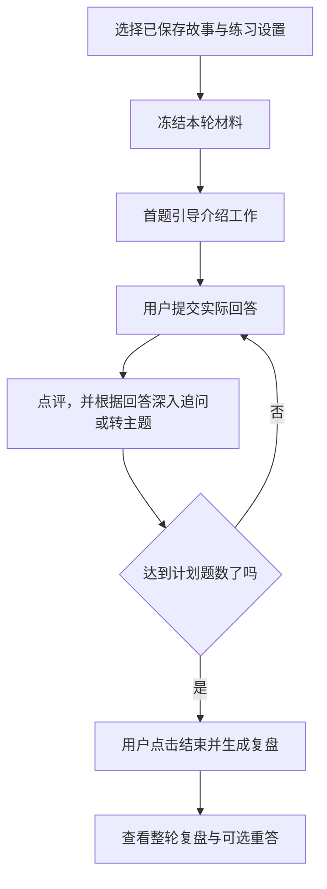

# 05 面试准备与训练：先讲清工作，再练深入追问

[返回指南首页](README.md) · [上一章：简历工作室](04-resume-workspace.md) · [下一章：求职体检](06-job-search-review.md)

面试准备的核心是两件事：**能完整讲清简历中的重要工作，能够回答面试官接下来的深入问题。** 针对某个 JD 的个性化问题属于额外准备，不应挤占这两项。

## 1. 为什么先准备故事，而不是直接刷题

面试官问“介绍一下这个项目”，通常不只是想听组件名单，而是想理解你的责任、问题、选择、做法和结果。如果这一层没有讲清，追问就容易变成互不相连的术语问答。

因此，产品先读取简历，把其中有实质内容的工作整理成故事初稿。**用户不需要先自己写好几条完整故事，才能开始使用。**

简历中有三块重要工作，就应分别覆盖；同一目标下连续的设计、实现和反馈也不应机械拆成许多组件碎片。按实际工作组织，不按 PDF 换行或编号硬拆。

## 2. 一条故事怎样组织

| 层次 | 要讲清楚什么 | 不能只写成什么 |
| --- | --- | --- |
| 我负责什么 | 项目目标，以及本人承担的具体工作 | “参与整个项目” |
| 当时的问题 | 要解决的情况、限制或困难 | “为了提升体验” |
| 我做了什么 | 实际采取的办法与关键步骤 | 技术名词清单 |
| 为什么这样做 | 选择依据、替代办法与取舍 | “为了更准确、更高效” |
| 结果如何 | 实际交付、观察或仍未解决的问题 | 把预期目标写成已实现效果 |
| 复盘与启发 | 从这件工作得到的具体认识 | “提高了能力，收获很大” |

六节的作用是帮助组织逻辑。练习时可以自然连起来讲，不必照读标题。每条抓住关键选择，避免六节重复；没有数字也可以形成可信故事。

### “有提到”为什么还不够

以一个**虚构的检索项目**为例，只说“语义和关键词提供不同角度的材料”，没有解释为什么需要它们。

更具体的机制说明可以是：

> 用户问“假期怎么休”，文档可能写的是“年假管理办法”，字面不同，语义检索有助于找到意思接近的段落。但产品编号、错误码这类精确词，语义相似并不总能可靠保留；关键词检索可以补充包含这些词的材料。合并两路结果后，还要处理重复和相关程度不一致的问题，再决定给回答环节哪些上下文。

这段说明回答了每一步解决什么问题、前一步为什么仍有不足。它只是机制示例；本人当时是否遇到这些情况、为什么选这套办法、怎样验证结果，仍须以真实经历填写，不能把示例变成个人历史。

检查一条故事时，要问“听完能否理解关键方法怎样起作用、为什么需要这个选择”，不能只问“是否出现了相关术语”。

## 3. 根据简历准备初稿，实际怎么做

1. 在 **面试训练** 选择适当的已启用简历，点击 **根据简历准备故事**。
2. 系统读取源简历和适用的已确认资料，建立可引用的来源，再让模型整理重要工作。
3. 程序检查故事编号、来源引用和必要内容，保存原生成稿、当前稿和来源快照。
4. 你逐条阅读，核实责任、做法、结果和复盘，修改误解，补充确实影响讲述的关键事实。

已有材料能支持的内容，产品应直接组织清楚；不知道的实际决策或结果，只留下具体待补事项，不为填满六节而编造经历。一般原理可以解释，但不能写成本人当时真的做过的比较或实验。

准备稿本身有版本。关闭后可以重开，不必重新请求模型来获取同一份稿件。

## 4. 直接修改与补充整理有什么区别

| 你想做什么 | 操作 | 实际处理 |
| --- | --- | --- |
| 这句话不准确，自己知道怎么改 | 修改这条故事 → 保存这条故事 | 本地保存正文，不调用模型，其他故事保留 |
| 补充了真实情况，希望系统重新组织 | 补充情况，让系统重新整理这一条 → 补充并重新整理这一条 | 使用已保存正文与本次补充，只重新整理指定故事 |
| 先练现有稿件 | 选择故事开始练习 | 有待补提示也能开始，不强迫先填完全部空缺 |

如果先手动改了正文，再想使用补充整理，应先保存正文，让重新整理读取的是你已经核实的版本。

保存准备稿表示“这份草稿留在本地供准备”，不等于已经确认其中所有内容可以成为跨模块使用的个人事实。

## 5. 开始训练后，系统怎样追问

选择一条或多条已保存故事，设置题目侧重、难度和题数，再开始。默认通用练习不需要先有面试邀请，也不依赖目标岗位。

开始时会核对故事版本、简历归属和来源，冻结本轮使用的故事与简历；岗位模式还会冻结选中的 JD。之后修改准备稿，不会悄悄篡改已经开始的这一轮。

首题让你讲清选中的工作；后续根据你的实际回答，追问依据、取舍、实施、验证和经验。例如，你提到“用唯一键避免重复库存流水”，后续可以追问冲突如何返回、怎样确认不会重复入库，而不是突然跳到无关知识题。

达到某主题的有效深度后可以自然换主题，不要求整轮反复抠一个小细节。你如实说“没做过压测，只做过功能回归”，也不应被自动判断为全部不会；可以另外讨论假设方案，但假设要保留为假设。

模型点评或下一题生成失败时，本轮不会把这次未完成处理写成已经成功回答，页面保留输入供恢复。

## 6. 岗位定制放在哪里

需要时选择 **结合目标岗位练习（可选）**，再选择资料完整的目标 JD。岗位要求用于增加有针对性的适配问题。

例如，同一段检索经历，在偏工程接入的岗位可能更关注服务边界，在偏效果优化的岗位可能更关注评测。但先讲清本人真实工作这件事不变。

没有目标岗位也能先完成核心准备。旧会话和直接练习入口继续保留，不要求先把所有旧记录迁移成故事准备稿。

## 7. 练完得到什么，怎样继续改

每题反馈说明答得好的地方与具体缺口。答完计划题数后，点击 **结束并生成复盘**；系统再结合前后回答，给出优点、改进方向、可能的追问、回答提纲与重练建议。报告生成后，再选择需要重答的题。

后续回答已经解释清楚的点，不应继续说成整轮完全没讲；没考到的能力，也不能因此判成不会。反馈是练习建议，不提供录用概率。

完成后可以自选某题 **保存重答并比较**。原回答与重答都保留，比较重点是是否补上原来的关键缺口，而不是字数更长、术语更多。

## 8. 哪些内容会成为后续可用的真实经历

下面三件事必须分清：

| 内容 | 默认身份 |
| --- | --- |
| 模型生成的准备故事和示范提纲 | 准备材料，不能自动当作新事实 |
| 用户提交的回答、重答 | 训练记录，不自动进入共享经历 |
| 用户另行核实、确认保存的真实片段 | 可供相关回复、简历优化与后续练习参考的经历 |

要保存可复用经历，在 **保存这次提到的真实经历** 中选择实际回答的连续原话，检查整理内容，再按 **确认并保存这段经历**。程序还会检查引用确实出自对应回答或重答。

确认后可在沟通资料中修改或停止使用。撤回的事实不应继续用于新生成内容；过去已经保存的草稿和训练记录保留历史。

### 核对实现的位置

- [用户确认的面试设计](../mock_interview_design.md)。
- [故事、训练与确认流程](../../src/application/mock_interview/index.js)。
- [故事与问答校验](../../src/core/mock_interview.js)、[生成任务](../../src/adapters/models/structured.js)。
- [面试页面](../../src/dashboard/pages/mock_interview.js)、[准备稿和训练保存](../../src/storage/mock_interview_store.js)。
