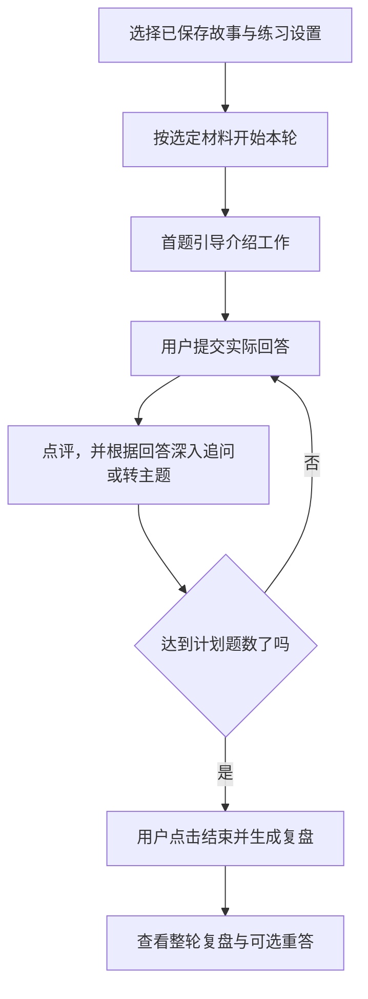

# 05 面试准备与训练：先讲清工作，再练深入追问

[返回指南首页](README.md) · [上一章：简历工作室](04-resume-workspace.md) · [下一章：求职体检](06-job-search-review.md)

面试准备先做好两件事：**完整讲清简历中的重要工作，练好面试官接下来的深入问题。** 有目标岗位时，再增加针对 JD 的练习。

## 1. 为什么先准备故事，而不是直接刷题

面试官问“介绍一下这个项目”，通常不只是想听组件名单，而是想理解你的责任、问题、选择、做法和结果。如果这一层没有讲清，追问就容易变成互不相连的术语问答。

产品会先读取简历，把重要工作整理成故事初稿。你从现成稿件上修改、补充，再直接开始练习。

简历中有三块重要工作，就分别准备三条故事。同一目标下连续的设计、实现和反馈，则连成一条完整经过，便于自然讲述。

## 2. 一条故事怎样组织

| 层次 | 要讲清楚什么 | 不能只写成什么 |
| --- | --- | --- |
| 我负责什么 | 项目目标，以及本人承担的具体工作 | “参与整个项目” |
| 当时的问题 | 要解决的情况、限制或困难 | “为了提升体验” |
| 我做了什么 | 实际采取的办法与关键步骤 | 技术名词清单 |
| 为什么这样做 | 选择依据、替代办法与取舍 | “为了更准确、更高效” |
| 结果如何 | 实际交付、观察或仍未解决的问题 | 把预期目标写成已实现效果 |
| 复盘与启发 | 从这件工作得到的具体认识 | “提高了能力，收获很大” |

六节的作用是帮助组织逻辑。练习时可以自然连起来讲，不必照读标题。每条抓住关键选择，避免六节重复；没有数字也可以形成可信故事。

### “有提到”为什么还不够

以一个**虚构的检索项目**为例，只说“语义和关键词提供不同角度的材料”，没有解释为什么需要它们。

更具体的机制说明可以是：

> 用户问“假期怎么休”，文档可能写的是“年假管理办法”，字面不同，语义检索有助于找到意思接近的段落。但产品编号、错误码这类精确词，语义相似并不总能可靠保留；关键词检索可以补充包含这些词的材料。合并两路结果后，还要处理重复和相关程度不一致的问题，再决定给回答环节哪些上下文。

这段说明讲出了每一步的作用，以及为什么还需要下一步。在自己的故事中，再加入当时遇到的情况、选择依据和验证结果，就能把方法与实际工作连起来。

检查一条故事时，要问“听完能否理解关键方法怎样起作用、为什么需要这个选择”，不能只问“是否出现了相关术语”。

## 3. 根据简历准备初稿，实际怎么做

1. 在 **面试训练** 选择适当的已启用简历，点击 **根据简历准备故事**。
2. 系统结合简历和你确认过的相关经历，按工作内容整理故事。
3. 生成后保存准备稿，关闭页面也能重开继续修改。
4. 阅读责任、做法、结果和复盘，补充简历里没有展开的关键情况。

已有内容会先组织成稿；缺少实际决策或结果时，页面列出具体补充提示。你可以边练边补，逐步完善。

## 4. 直接修改与补充整理有什么区别

| 你想做什么 | 操作 | 实际处理 |
| --- | --- | --- |
| 这句话不准确，自己知道怎么改 | 修改这条故事 → 保存这条故事 | 保存这一条的文字，其他故事保留 |
| 补充了真实情况，希望系统重新组织 | 补充情况，让系统重新整理这一条 → 补充并重新整理这一条 | 使用已保存正文与本次补充，只重新整理指定故事 |
| 先练现有稿件 | 选择故事开始练习 | 有待补提示也能开始，不强迫先填完全部空缺 |

如果先手动改了正文，再想使用补充整理，应先保存正文，让重新整理读取的是你已经核实的版本。

## 5. 开始训练后，系统怎样追问

选择一条或多条已保存故事，设置题目侧重、难度和题数，再开始。默认通用练习不需要先有面试邀请，也不依赖目标岗位。

这一轮始终参考开始时选定的故事和简历，岗位模式还会参考选中的 JD。练习中再修改准备稿，会留给下一轮使用，这样题目与回答能围绕同一份材料展开。

首题让你讲清选中的工作；后续根据你的实际回答，追问依据、取舍、实施、验证和经验。例如，你提到“用唯一键避免重复库存流水”，后续可以追问冲突如何返回、怎样确认不会重复入库，而不是突然跳到无关知识题。

一个问题讲透后，可以自然转向其他工作。回答时按实际经验说明，例如“做过功能回归，压测会怎样设计”，既能讲清已有工作，也能练习延伸思考。

点评或下一题生成中断时，页面会保留输入，恢复后可以继续处理。

## 6. 岗位定制放在哪里

需要时选择 **结合目标岗位练习（可选）**，再选择资料完整的目标 JD。岗位要求用于增加有针对性的适配问题。

例如，同一段检索经历，工程接入岗位更可能追问怎样连入现有系统，效果优化岗位更可能追问怎样验证检索质量。准备好通用故事后，再加上这些有针对性的问题。

没有目标岗位时，先完成通用故事与深入追问即可。已有的训练也能从历史会话继续。

## 7. 练完得到什么，怎样继续改

每题反馈说明答得好的地方与具体缺口。答完计划题数后，点击 **结束并生成复盘**；系统再结合前后回答，给出优点、改进方向、可能的追问、回答提纲与重练建议。报告生成后，再选择需要重答的题。

复盘会结合前后回答，看你是否讲清问题、选择、做法与结果。后面补充清楚的内容，也会纳入整体评价。

完成后可以自选某题 **保存重答并比较**。原回答与重答都保留，比较重点是是否补上原来的关键缺口，而不是字数更长、术语更多。

## 8. 哪些内容会成为后续可用的真实经历

如果练习时讲清了一段真实经历，希望以后改简历或回复 HR 时继续使用，可以在 **保存这次提到的真实经历** 中选择回答原话，检查整理内容，再按 **确认并保存这段经历**。

保存后，相关回复、简历和后续练习可以参考它。到沟通资料中可修改或停止使用，已有准备稿与训练记录仍可回看。
