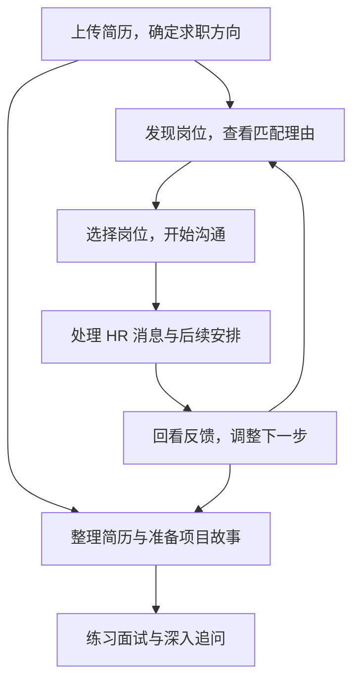

# OfferGo 用户说明与设计指南

**OfferGo 帮你从简历出发，找到值得争取的岗位，处理 HR 消息，并准备简历和面试。** 求职过程中看过什么、联系过谁、下一步该做什么，都可以在同一个工作台里接着处理。

这份指南先介绍怎样使用，再解释各模块为什么这样设计、内部怎样处理信息。文中的 **JD** 就是招聘方写的岗位描述，包括职责、要求和条件；例子均为虚构情境。

## 1. 你现在想做什么

| 想解决的问题 | 去哪里看 |
| --- | --- |
| 第一次使用，想让系统理解我的简历与求职方向 | [01 首次使用与求职方向](01-getting-started.md) |
| 找岗位，了解为什么推荐、差距在哪里 | [02 找岗与岗位判断](02-job-discovery-and-matching.md) |
| 联系 HR、回复消息、发送简历或记录面试进展 | [03 沟通、消息与进展](03-communication-and-progress.md) |
| 项目经历写得不清，或想为某个岗位调整简历 | [04 简历工作室](04-resume-workspace.md) |
| 不知道项目怎么讲，想准备故事并练深入追问 | [05 面试准备与训练](05-interview.md) |
| 联系了一批岗位，想知道接下来先改什么 | [06 求职体检与改进](06-job-search-review.md) |
| 设置模型、查看资料位置，或恢复中断任务 | [07 设置、资料与恢复](07-settings-data-and-recovery.md) |
| 使用的页面与指南不同，或想查其他说明 | [08 版本与更多资料](08-status-and-documents.md) |

第一次看，可以接着读下面的全程介绍；已经在用，可以直接打开对应章节。

## 2. 从简历到求职反馈，怎样连起来

你可以先整理简历、准备面试，也可以直接处理之前就存在的 HR 会话。几个模块围绕同一份求职资料配合，按你当前最需要解决的事开始即可。

### 一个完整例子

小周做过文档问答工具，负责检索和接口对接，想找应用开发岗位。

1. **建立方向。** 上传简历后，OfferGo 整理出他的工作经历、相关能力和可寻找的岗位方向。小周检查这些内容，设置城市、薪资等偏好。
2. **挑选机会。** 系统读取岗位的完整介绍。知识库问答与工程接入岗位能对应他做过的工作；底层模型训练岗位则存在不同的能力要求。推荐理由会展开这些关联与差距。
3. **联系和回复。** 小周选好岗位，确认清单并开始沟通。HR 问“检索部分具体做过什么”时，系统结合已有经历准备回复草稿，他可以直接修改和发送。
4. **准备面试。** 系统把检索工作整理成故事初稿。小周补充当时为什么这样选、结果怎样，再围绕这条故事练深入追问。
5. **根据反馈改进。** 若 HR 提到“本人职责不够清楚”，求职体检会引导他对照原回答与项目描述，先把这段分工讲清楚。

你得到的不只是几条独立建议，而是一套可以接着使用的资料、岗位记录和准备材料。

## 3. 页面怎样配合

| 页面 | 主要用途 |
| --- | --- |
| 今日任务 | 选择求职方案与平台，开始或继续一轮找岗 |
| 发现岗位、岗位记录 | 看岗位内容、匹配理由、待补资料与后续进度 |
| 沟通清单与记录 | 选择主动联系的岗位，查看每项执行结果 |
| 消息与回复 | 看 HR 原文，处理问题、简历请求和待回复事项 |
| 简历工作室 | 整理整份简历，或为某个岗位调整表达 |
| 面试训练 | 准备项目故事、练习追问、查看反馈和重答 |
| 求职体检 | 结合具体反馈与一段时间的进展，判断先检查哪里 |
| 招聘平台、模型与设置、运行诊断 | 准备连接、管理设置和处理运行问题 |

首次建立求职方案后，侧栏会显示围绕该方案的完整功能。

## 4. 为什么按这条流程设计

**从实际工作判断机会。** 标题相似、技术词相同，做的工作可能很不同；专业名称不同，也可能有直接相关的经历。岗位分析先看日常工作与交付，再看你的经历如何对应。

**保留值得尝试的机会。** 投递是在寻找机会。真正合适的岗位优先，有关联但存在差距的岗位也保留给你选择。

**沿用已经整理好的资料。** 已有简历、有效的岗位分析和确认过的经历会继续使用，减少重复填写与重复分析。资料更新后，相关判断再随之更新。

**把准备材料做成能直接用的结果。** 简历模块交付完整草稿，面试模块先准备故事，消息模块提供回复和对应操作。你可以在结果上修改，逐步完善。

**从反馈中选一件值得改的事。** 一条明确反馈可以提示检查具体表达；积累一段时间后，再看整体进展卡在哪一步，避免每次没回复就从头改简历。

## 5. 电脑里哪些部分在配合

| 部分 | 做什么 |
| --- | --- |
| 本地工作台网页 | 接收你的选择，展示岗位、草稿和进度 |
| 后台任务程序 | 继续处理找岗等较长任务，并保存进度 |
| 本地数据库与文件 | 保存简历、岗位、会话、版本和历史记录 |
| 已登录的 Edge | 读取招聘平台页面，执行你确认的沟通操作 |
| 模型服务 | 理解简历和岗位，整理推荐理由、回复与练习材料 |

例如，点击开始找岗后，程序先读取你的方案，再通过 Edge 取得岗位资料，交给模型分析，保存结果后显示到页面。网页会不断更新进度，已经保存的结果可以在后续继续使用。

普通用户从页面操作；委托 AI 助手时，也可以通过命令行使用同一套流程。连接与资料位置见[第07章](07-settings-data-and-recovery.md)。

本指南包含当前开发版的改进。安装版的功能差别、版本信息与开发参考集中在[第08章](08-status-and-documents.md)。
