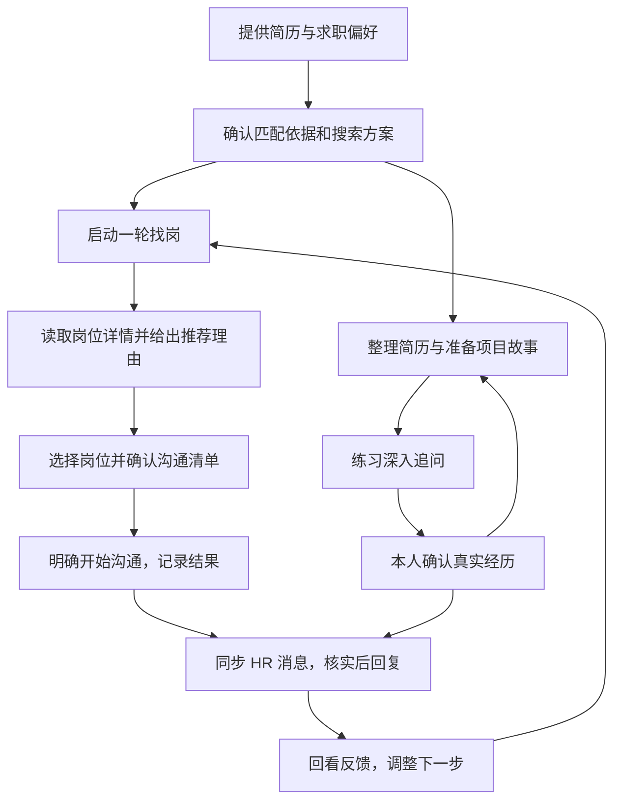

# OfferGo 用户说明与设计指南

**OfferGo 帮你把“看简历、找岗位、判断机会、联系 HR、准备面试、回看效果”连成一条能持续使用的求职流程。** 它先整理资料、提供判断和草稿，再由你决定方向、核实经历并确认对外操作。

这份指南既说明怎么用，也展开每一步为什么这样设计、程序实际怎样处理信息。你不需要先懂代码。

> **阅读范围：** 2026 年 10 月 16 日，按源码 `1d8eab0` 核对。本文包含最近的面试故事准备、简历分区编辑和具体反馈复盘。仓库的 v1.4.1 安装版说明对应较早的发布版本，不包含全部后续改进；[当前能力与版本区别](08-status-and-documents.md)单独说明。文中的例子均为说明设计的虚构情境。

## 1. 这个项目解决什么问题

求职的困难往往不是缺少一个搜索框，而是信息与行动散落在不同地方：简历里写了什么、哪些岗位值得争取、哪些已经联系、HR 问过什么、下一次应该改哪里，很容易脱节。

本指南中的 **JD** 指招聘方写的岗位描述，主要包括职责、要求和条件。

OfferGo 围绕同一份求职资料组织这些工作：

| 你遇到的问题 | 项目怎样帮助你 |
| --- | --- |
| 不知道自己的经历能对应哪些岗位 | 整理候选人画像，形成可检查的匹配偏好卡和搜索方案 |
| 岗位太多，标题又不一定说明实际工作 | 读取完整岗位描述，结合你的真实经历判断主体工作是否合适 |
| 看过很多岗位，重复、遗漏和进度记不住 | 保存岗位来源、详情、分析和沟通进度，区分新岗位、旧结果与待补资料 |
| 想联系 HR，却不想误发或重复联系 | 先形成具体清单，由你确认并启动，再逐项核对执行结果 |
| HR 来信后不知道该怎么回 | 展示原文、整理待办、准备可修改的回复；缺少个人事实时再请你补充 |
| 简历写得散，项目又讲不清 | 按原简历结构编辑，并主动整理项目故事和深入追问练习 |
| 没收到回复，就想把整份简历重写 | 结合真实联系记录、观察时间和具体反馈，判断先检查什么 |

项目提供的是寻找机会与改进表达的帮助。岗位推荐不是录用承诺，生成的文字也不是已经核实的个人经历。

## 2. 先看一遍完整流程

这条流程不是强制顺序。你可以先整理简历、准备面试，也可以直接处理使用 OfferGo 之前就存在的 HR 会话。**找岗不会自动变成沟通，保存草稿不会自动变成发送。**

### 一个贯穿全程的例子

假设小周做过一个文档问答工具，负责检索和接口对接，想找应用开发岗位：

1. 上传简历后，他先核对系统有没有准确理解“本人负责检索与接口”，而没有扩大成“独立负责整个产品”。
2. 保存城市、薪资等偏好，确认匹配卡，开始找岗。
3. 一个岗位主要做知识库问答与工程接入，系统结合完整 JD 解释可对应的工作和差距；另一个主要训练底层模型，系统不能因为都出现“AI”就认定适合。
4. 小周选择值得了解的岗位，确认清单，再明确开始沟通。
5. HR 问“检索部分具体做过什么”，项目先给回复草稿；如果缺少实际结果，小周补充真实情况后再发送。
6. 面试前，项目把检索这块工作整理成故事初稿，小周核实，再练“为什么这样选、解决了什么、有什么取舍”等深入问题。
7. 后续若 HR 明确说“看不出你本人负责哪部分”，求职体检可以据此建议检查项目职责表达；它不会直接认定小周没有能力，也不会自动重写简历。

各章会继续展开这些判断，而不是把它们缩成一个“AI 自动处理”。

## 3. 页面分别负责什么

| 页面或能力 | 核心职责 | 详细说明 |
| --- | --- | --- |
| 首次使用、画像、匹配偏好卡与搜索方案 | 说明“我是谁、找什么、按什么依据匹配” | [01 首次使用与求职方向](01-getting-started.md) |
| 今日任务、发现岗位 | 启动和查看一轮找岗，处理暂停与待补工作 | [02 找岗与岗位判断](02-job-discovery-and-matching.md) |
| 岗位记录 | 保留岗位、理由、资料状态和后续进度 | [02 找岗与岗位判断](02-job-discovery-and-matching.md) |
| 沟通清单与记录 | 确认主动联系的具体对象，核对执行结果 | [03 沟通、消息与进展](03-communication-and-progress.md) |
| 消息与回复、沟通资料 | 整理新来信、准备回复、补充并管理本人事实 | [03 沟通、消息与进展](03-communication-and-progress.md) |
| 简历工作室 | 通用整理、单岗位调整、按原简历结构编辑和管理版本 | [04 简历工作室](04-resume-workspace.md) |
| 面试训练 | 准备项目故事、练深入追问、查看反馈与重答 | [05 面试准备与训练](05-interview.md) |
| 求职体检 | 区分统计信号与具体反馈，决定优先检查哪里 | [06 求职体检与改进](06-job-search-review.md) |
| 招聘平台、模型与设置、运行诊断 | 准备外部连接，管理模型、资料和恢复 | [07 设置、资料与恢复](07-settings-data-and-recovery.md) |

首次没有求职方案时，导航会比较少。建立并确认资料后，才会出现围绕该方案的完整页面。这不是功能丢失。

## 4. 项目怎样运行，系统、模型和你怎样分工

电脑上主要有下面几部分配合：

| 部分 | 实际做什么 |
| --- | --- |
| 本地工作台网页 | 接收你的选择，展示岗位、草稿和进度 |
| 后台任务程序 | 执行找岗等较长任务，按步骤保存结果，让页面能继续显示进度 |
| 本地数据库与文件 | 保存资料、版本、岗位、会话和检查点，供下次接着使用 |
| 已登录的 Edge | 展示招聘平台页面，是读取岗位和执行授权动作的通道 |
| 配置的模型服务 | 接收任务所需材料，返回理解、判断或生成内容 |

一次操作通常是“页面接收选择 → 程序读取本地资料并安排任务 → 必要时访问模型或平台 → 保存结果 → 页面展示”。网页与命令行是两种入口，共用项目的业务规则；它不是要求部署多台服务器的系统。

模型给出的建议不会直接变成招聘平台点击。外部执行仍经过程序的目标核对、用户确认与结果检查。

### 系统负责把流程做可靠

程序保存资料版本，检查必要输入，读取和去重岗位，安排任务，核对来源与操作目标，记录完成、暂停和失败。具体发送结果不明确时，它保留问题，避免把一次不确定操作自动再做一遍。

### 模型负责理解和组织内容

模型理解简历与完整 JD，判断工作关联，整理匹配理由，生成回复、简历草稿、故事初稿和面试反馈。模型输出需要通过程序的格式、来源和必要内容检查；通过这些检查，也不代表每句话都准确或写得好。

### 你负责决定方向、核实个人事实和确认外部动作

你不必替项目手工整理完整故事或重新填写整份简历。但真正做过什么、能接受哪些条件、准备联系谁、最终发出什么，需要由你核实或决定。

这三者贯穿各模块：**把能自动完成的整理交给产品，把个人选择与事实确认留在明确的位置。**

## 5. 项目的几个核心设计取舍

**先看实际工作，再看技术词汇。** 两份 JD 都写 Python，不代表做的是同一种工作；不同专业的人，也可能有直接相关的开发经历。

**投递是寻找机会。** 真正合适的岗位应尽量保留，明显不合适的应排除；有关联但存在差距的岗位可以尝试。系统不应为了替 HR 做所有资格核验，把普通信息遗漏都变成拒绝理由。

**资料与结论分开保存。** 岗位详情是分析依据，推荐是基于某个简历、方案与分析版本形成的判断。条件变化后，旧判断可能需要更新；它不是永远有效的标签。

**生成、保存、确认、发送是不同动作。** 本地草稿可以修改和重开；对外动作需要明确目标与确认；练习中的回答也不会自动成为本人已确认的事实。

**统计和具体反馈互相补充。** 样本少时不乱下结论，但一条具体 HR 原话仍然可以支持一次有针对性的检查。

**流程通过与内容好用分别判断。** 自动检查能发现流程错误；故事是否讲清了关键选择、回复是否自然、推荐是否符合招聘实际，还需要看具体结果。

## 6. 你想看什么，可以从这里进入

- **第一次用：** 从 [01 首次使用](01-getting-started.md)开始，跟着完成一轮找岗与确认。
- **想弄懂核心判断：** 看 [02 岗位判断](02-job-discovery-and-matching.md)、[05 面试设计](05-interview.md)和 [06 体检策略](06-job-search-review.md)。
- **已经在用，遇到问题：** 看 [07 设置与恢复](07-settings-data-and-recovery.md)，再进入对应模块。
- **想核对实现与开发现状：** 各章末尾有源码依据；[08 当前状态与文档地图](08-status-and-documents.md)说明设计、实现、验收和发布的区别。

这份指南是理解当前产品的主入口。历史计划、实验结果和旧流程图继续保留，查某次设计的来由时再阅读，不要求用户先读完开发档案。
